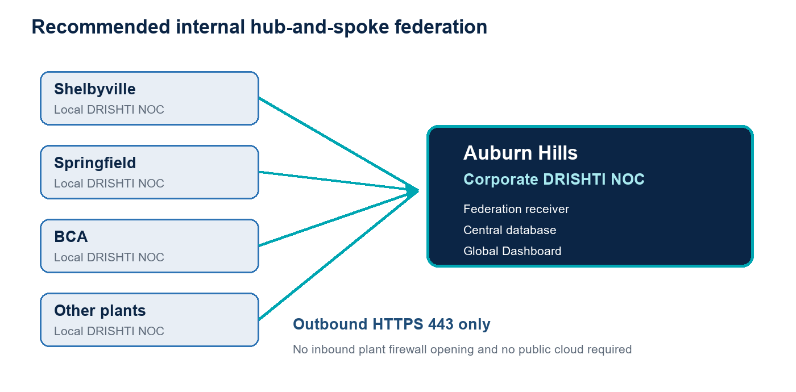

**MARTINREA INTERNAL**

**DRISHTI NOC  
Multi-Plant Federation**

Detailed Project Plan for Centralized Corporate Monitoring

| **Prepared for** | Martinrea Corporate IT, Cybersecurity, Network Services, and Plant IT |
| --- | --- |
| **Corporate hub** | Auburn Hills, Michigan |
| **Initial pilot** | Shelbyville, Kentucky |
| **Document status** | Version 1.0 - Planning and Approval - 14 July 2026 |

**Recommended decision: **Build an internal, outbound-push federation service. Every plant keeps its own local DRISHTI NOC, while Auburn Hills receives secure health, inventory, alert, and heartbeat data for one corporate Global Dashboard.

_This plan is written for IT personnel with limited knowledge of DRISHTI. Technical terms are explained in plain language, and detailed configuration examples are clearly marked as proposed future functionality._

# How to Use This Document

Read Sections 1 through 4 first to understand the business goal, recommended architecture, scope, and requirements. Project teams can then use the implementation, pilot, rollout, and operational sections as working checklists.

**•  Executives and sponsors: **Sections 1, 3, 8, 15, and 18.

**•  Network and cybersecurity teams: **Sections 4, 6, 10, and 11.

**•  DRISHTI developers and application owners: **Sections 6, 7, 8, and 12.

**•  Plant IT teams: **Sections 9, 13, 14, and Appendix A.

**•  Service desk and operations: **Sections 12, 14, and Appendix D.

**Important: **HF021 does not contain federation. The APIs, database tables, user interface, and environment variables described in this plan are requirements for a new DRISHTI release.

# 1. Executive Summary

Martinrea requires a centralized view of all plant locations without removing each plant's ability to operate independently. Auburn Hills will act as the corporate DRISHTI NOC hub. Shelbyville, Springfield, BCA, and future plants will continue running their own local DRISHTI NOC deployments.

A new federation service will securely transmit selected operational data from each plant to Auburn Hills over the Martinrea network. The corporate team will see plant health, devices, switches, servers, virtual machines, cameras, internet circuits, alerts, and last-contact status on one Global Dashboard.

**Key point: **Creating a location and entering its physical address does not discover devices. The location record is only organizational metadata. Device information must come from the local plant DRISHTI database through the new federation service.

## 1.1 Business outcomes

•  Corporate IT can monitor all participating plants from Auburn Hills.

•  Plant IT retains its local dashboard and can continue working during a WAN outage.

•  Corporate users see which plant is online, stale, or disconnected.

•  Alerts and critical conditions can be reviewed centrally without sharing plant credentials.

•  New plants can be onboarded through a repeatable and auditable process.

## 1.2 Recommended delivery approach

Use an internal hub-and-spoke design with outbound HTTPS connections from each plant. Do not expose plant frontend port 5173, connect databases across sites, or scrape plant web pages. Auburn Hills should expose only the secured federation API through production HTTPS on TCP 443.

# 2. Plain-Language Solution Overview

Each plant is a spoke and Auburn Hills is the hub. A small background service in the plant DRISHTI application prepares a standardized snapshot and sends it to Auburn Hills. Auburn verifies the plant identity, stores the latest data, and combines it with local Auburn information.

_Figure 1. Recommended internal DRISHTI federation architecture_

## 2.1 Terms in simple language

| **Term** | **Meaning** |
| --- | --- |
| Corporate hub | The Auburn Hills DRISHTI NOC that receives and displays information from all plants. |
| Plant node | A local DRISHTI NOC deployment at Shelbyville, Springfield, BCA, or another plant. |
| Federation | A secure method for several independent DRISHTI systems to share selected information. |
| Heartbeat | A small message that tells Auburn the plant service is still connected. |
| Snapshot | The latest plant inventory, system health, and alert data sent to Auburn. |
| Stale | A warning that Auburn has not received a recent update and is showing older data. |

## 2.2 What the solution will and will not do

| **The solution will** | **The solution will not** |
| --- | --- |
| Show all registered plants on one corporate dashboard. | Discover devices from a street address, city, or state. |
| Copy approved inventory, health, and alert data to Auburn. | Send SSH passwords, SNMP secrets, collector tokens, or local user passwords. |
| Keep plant monitoring operational during a WAN interruption. | Require Auburn to connect directly to every device at every plant. |
| Show last-sync time and plant connection state. | Use port 5173 as the federation interface. |

# 3. Project Scope

## 3.1 Included in the initial project

•  Auburn Hills corporate federation receiver and secure site registration.

•  Plant-side synchronization service within DRISHTI.

•  Federated site, asset, alert, and heartbeat database storage.

•  Corporate Remote Sites administration page.

•  Global Dashboard integration and per-plant drill-down.

•  Online, stale, offline, disabled, and version-incompatible site states.

•  Token issuance, rotation, revocation, audit logging, retry handling, and payload validation.

•  Shelbyville pilot followed by controlled rollout to Springfield, BCA, and other plants.

•  Operational documentation, monitoring, backup, recovery, and service-desk handoff.

## 3.2 Not included unless separately approved

•  Direct corporate access to plant databases.

•  Automatic device discovery based on a physical address.

•  Public internet exposure of plant DRISHTI systems.

•  Remote configuration changes to plant switches or servers from Auburn.

•  Full replication of plant user accounts or local credentials.

•  Replacement of existing Martinrea WAN, SD-WAN, VPN, DNS, PKI, or backup platforms.

•  High-availability clustering unless it is added as a separate infrastructure requirement.

# 4. Requirements

The project needs both infrastructure preparation and application development. Infrastructure teams should not wait for coding to finish before starting DNS, certificate, routing, firewall, server, and security reviews.

## 4.1 Corporate Auburn Hills requirements

| **Topic** | **Requirement** | **Primary owner** |
| --- | --- | --- |
| Server | Production Linux server or approved container host for corporate DRISHTI NOC. | Corporate Infrastructure |
| Database | PostgreSQL capacity, backup, restore testing, and retention for federated data. | DBA / Application Owner |
| DNS | Internal FQDN such as drishti-corporate.martinrea.com. | Network / DNS |
| HTTPS | Martinrea-trusted certificate; TLS 1.2 or newer; renewal process documented. | PKI / Cybersecurity |
| Firewall | Inbound TCP 443 at Auburn from approved plant DRISHTI source networks only. | Network Security |
| Time | Reliable NTP synchronization for tokens, timestamps, and troubleshooting. | Infrastructure |
| License | Unlimited/Site License recommended for production corporate aggregation. | Sponsor / Application Owner |
| Operations | Monitoring, alert ownership, maintenance window, backup, and incident procedures. | NOC / Service Desk |

## 4.2 Plant requirements

•  A supported local DRISHTI NOC deployment with a unique deployment identity.

•  A correctly configured local location record, such as Shelbyville.

•  Outbound routing and TCP 443 access to the Auburn corporate FQDN.

•  DNS resolution and trust for the Auburn HTTPS certificate.

•  A unique federation token generated by Auburn and stored as a protected secret.

•  A designated Plant IT owner and escalation contact.

•  Correct local device-to-location assignments before synchronization begins.

•  NTP synchronization and enough local logging space for retry history.

## 4.3 Organizational and policy requirements

•  Cybersecurity approval for operational data containing hostnames, IP addresses, statuses, and alerts.

•  A decision on data retention and whether corporate may retain resolved alerts.

•  Change-management approval for corporate and plant deployments.

•  Named owners for corporate application support, network support, cybersecurity, and each plant.

•  A version-support policy so incompatible plants are upgraded before federation is enabled.

•  A licensing decision defining how federated assets count at corporate and plant deployments.

**Internal-only design: **No external cloud service is required when all plants can reach Auburn over Martinrea WAN, SD-WAN, MPLS, or VPN. If a site lacks internal routing, Martinrea Network and Cybersecurity must approve a managed VPN or DMZ relay before onboarding.

# 5. Roles and Responsibilities

| **Role** | **Main responsibilities** | **Required outputs** |
| --- | --- | --- |
| Executive sponsor | Approve scope, priority, funding, licensing, and risk acceptance. | Project authorization and escalation support |
| DRISHTI product/application owner | Own requirements, backlog, releases, application configuration, and acceptance. | Approved design, release package, support ownership |
| Corporate network team | Provide routing, DNS, firewall changes, and connectivity testing. | Approved network path and documented rule |
| Cybersecurity / PKI | Review data flow, certificate, token model, logging, encryption, and vulnerability results. | Security approval and certificate |
| Database / infrastructure team | Provide capacity, backup, recovery, monitoring, and operating-system maintenance. | Ready corporate platform and recovery evidence |
| Plant IT | Validate local inventory, install/configure federation, test, and provide ongoing first response. | Plant worksheet, successful pilot, support contact |
| Service desk / NOC | Monitor site status, create incidents, follow runbooks, and escalate. | Operational handoff and ticket workflow |
| DRISHTI development team | Build, test, document, package, and remediate federation functionality. | Tested cumulative release in both license variants |

# 6. Target Architecture and Data Flow

## 6.1 Connection model

1. **The plant creates a local snapshot. **DRISHTI reads its own local database and prepares only approved operational fields.

2. **The plant opens an outbound HTTPS connection. **The destination is the corporate federation API on TCP 443.

3. **Auburn authenticates the plant. **A unique site identifier and token are validated before accepting data.

4. **Auburn validates and stores the payload. **Records are upserted using deployment ID, resource type, and local resource ID.

5. **The Global Dashboard reads combined data. **Auburn local data and federated plant data remain logically separated but appear in one view.

6. **Auburn evaluates freshness. **Missing heartbeats change the plant state from online to stale and then offline.

## 6.2 Recommended synchronization schedule

| **Data** | **Recommended interval** | **Purpose** |
| --- | --- | --- |
| Heartbeat | 60 seconds | Confirm connection, version, and service health. |
| Health summary | 60 seconds | Update plant/system status tiles and critical counts. |
| Active alerts | 60 seconds or on change | Provide timely corporate alert visibility. |
| Full asset inventory | 5 minutes or on change | Reduce bandwidth while keeping inventory current. |
| Resolved alert history | 15 minutes | Support reporting without delaying operational updates. |

## 6.3 Site connection states

| **State** | **Condition** | **Corporate behavior** |
| --- | --- | --- |
| Online | Heartbeat received within 3 minutes. | Show current data and normal status colors. |
| Stale | No heartbeat for 3 to 10 minutes. | Show last data with warning banner and last-update time. |
| Offline | No heartbeat for more than 10 minutes. | Raise corporate alert; keep last known data read-only. |
| Disabled | Administrator intentionally disables federation. | Exclude from operational alerts but retain audit history. |
| Incompatible | Schema/application version cannot be accepted. | Reject payload safely and display required upgrade action. |

## 6.4 Information sent to Auburn

| **Included** | **Examples** | **Excluded** |
| --- | --- | --- |
| Site identity and heartbeat | Site ID, name, version, timestamps, sync status | Local passwords and user sessions |
| Asset identity and status | Hostname, IP, type, vendor, model, location, state | SSH passwords and private keys |
| Health metrics | CPU, memory, disk, latency, packet loss, port counts | SNMP authentication/privacy secrets |
| Alerts | Severity, asset, message, opened/updated/resolved times | Collector shared tokens |
| System summaries | Network, servers, VMs, cameras, ISP, endpoints | Unapproved logs or business-production data |

# 7. DRISHTI Application Development Work

**Current product status: **HF021 supports local/global dashboard filtering inside one DRISHTI database. It does not yet connect independent plant deployments. The following work must be developed, reviewed, tested, and packaged.

## 7.1 Corporate federation receiver

•  Remote Sites administration page with register, enable, disable, rotate-token, and revoke functions.

•  One-time token display during registration; only a secure hash remains in the corporate database.

•  Versioned receiver endpoints for heartbeat, snapshot, inventory, and alerts.

•  Request authentication, payload-size limits, schema validation, rate limiting, and audit records.

•  Idempotent database upserts so retrying the same update does not create duplicates.

•  Last-contact evaluation and automatic online/stale/offline transitions.

POST /api/federation/v1/heartbeat  
POST /api/federation/v1/snapshot  
POST /api/federation/v1/inventory  
POST /api/federation/v1/alerts

## 7.2 Corporate database additions

| **Proposed table** | **Purpose** |
| --- | --- |
| federated_sites | Plant identity, status, token hash, version, local URL, and administrative settings. |
| federated_heartbeats | Connection history, timestamps, latency, version, and errors. |
| federated_assets | Latest normalized plant asset inventory and health status. |
| federated_alerts | Active and retained plant alerts with acknowledgment mapping. |
| federated_sync_runs | Audit trail for received, accepted, rejected, and partially processed payloads. |

## 7.3 Plant synchronization service

•  Read only approved local DRISHTI data; do not query or modify devices during synchronization.

•  Attach deployment ID, location ID, schema version, sequence number, and generated-at time.

•  Use bounded retries with increasing delay and retain the newest unsent state.

•  Record success/failure locally without logging the federation token.

•  Support proxy and custom internal CA settings where Martinrea standards require them.

•  Continue local monitoring even when corporate synchronization fails.

## 7.4 Proposed plant configuration

_The following values are proposed future settings. They must not be added to HF021 expecting them to work._

FEDERATION_ENABLED=true  
FEDERATION_HUB_URL=https://drishti-corporate.martinrea.com/api/federation/v1  
FEDERATION_SITE_ID=<corporate-generated-site-uuid>  
FEDERATION_LOCATION_ID=<local-location-uuid>  
FEDERATION_TOKEN=<unique-one-time-site-token>  
FEDERATION_HEARTBEAT_SECONDS=60  
FEDERATION_INVENTORY_SECONDS=300  
FEDERATION_STALE_AFTER_SECONDS=180

## 7.5 Corporate dashboard changes

•  Combine Auburn local data with the latest accepted plant snapshots.

•  Display source plant and data-freshness time on every federated view.

•  Show a prominent stale/offline banner instead of presenting old data as current.

•  Provide per-plant tiles, table view, critical-system panel, alert view, and inventory drill-down.

•  Keep a controlled deep link to the local plant portal when routing and authorization permit it.

•  Prevent corporate actions from accidentally modifying plant-local assets in the initial release.

# 8. Step-by-Step Project Plan

The following schedule is a planning estimate, not a committed delivery date. The actual duration depends on network approvals, certificate readiness, development capacity, security review, and pilot findings.

| **Phase** | **Primary outcome** | **Indicative duration** | **Approval gate** |
| --- | --- | --- | --- |
| 0. Initiation | Approved scope, owners, plant list, and data policy | 2-5 business days | Sponsor approval |
| 1. Detailed design | Signed architecture, security, API, and database design | 1-2 weeks | Design review |
| 2. Auburn readiness | DNS, HTTPS, routing, server, DB, backup, monitoring | 1-2 weeks in parallel | Infrastructure ready |
| 3. Development | Corporate receiver, plant sender, UI, migrations, documentation | 3-5 weeks | Code complete |
| 4. Verification | Functional, security, resilience, load, upgrade, and packaging tests | 1-2 weeks | Release approval |
| 5. Shelbyville pilot | One plant connected and accepted | 1-2 weeks | Pilot sign-off |
| 6. Rollout waves | Springfield, BCA, and remaining plants connected | 2-5 days per plant | Plant sign-off |
| 7. Operations handoff | Runbooks, monitoring, ownership, and review cycle active | 3-5 business days | Service acceptance |

**Planning range: **A reasonable initial planning range is 8 to 12 weeks from approved design to a completed Shelbyville pilot, followed by controlled plant rollout. Network and security work should run in parallel with development.

## 8.1 Phase 0 - Initiation and decisions

1. Name the executive sponsor, application owner, technical lead, security reviewer, network lead, and plant pilot lead.

2. Confirm Auburn Hills as the corporate hub and Shelbyville as the pilot plant.

3. Create the authoritative plant list, local DRISHTI URLs, owners, server IPs, and local location IDs.

4. Approve full inventory plus active alerts as the initial synchronized data scope.

5. Approve internal-only outbound HTTPS as the network pattern.

6. Approve corporate retention, licensing, and support boundaries.

7. Open project, change, security-review, DNS, certificate, and firewall work items.

**Exit gate: **Sponsor and technical owners approve the scope, pilot, data classification, and delivery model.

## 8.2 Phase 1 - Detailed design

1. Document the logical and physical architecture, trust boundaries, ports, DNS, certificate, and failure behavior.

2. Define the versioned JSON contract and required/optional fields.

3. Define identity rules using deployment ID, resource type, and local resource ID.

4. Define token creation, storage, rotation, revocation, and incident response.

5. Define database schema, indexes, retention, archival, and cleanup jobs.

6. Define user roles for remote-site registration, viewing, token rotation, and disabling a plant.

7. Review the design with Corporate IT, Network, Cybersecurity, Plant IT, DBA, and Service Desk.

**Exit gate: **Approved architecture, API contract, data model, threat review, and test strategy.

## 8.3 Phase 2 - Auburn Hills infrastructure readiness

1. Confirm production server sizing, operating system, storage, patching, and support ownership.

2. Create the internal DNS record and validate it from Auburn and Shelbyville.

3. Issue and install the Martinrea-trusted HTTPS certificate.

4. Configure Nginx or the approved reverse proxy to expose only HTTPS 443.

5. Implement firewall rules limited to approved plant source networks where practical.

6. Confirm PostgreSQL backup, restore, monitoring, storage alerting, and retention capacity.

7. Confirm NTP, centralized logs, vulnerability scanning, endpoint protection, and OS hardening.

8. Run connectivity tests from Shelbyville to the corporate FQDN before application deployment.

**Exit gate: **Auburn infrastructure is production-ready and Shelbyville can reach HTTPS 443 with a trusted certificate.

## 8.4 Phase 3 - Development

1. Create corporate database migrations and repository/service layers.

2. Build Remote Sites administration with secure one-time token issuance.

3. Build receiver authentication, validation, rate limiting, idempotency, and audit logging.

4. Build plant heartbeat, summary, alert, and inventory synchronization workers.

5. Build retry/backoff, queued-latest-state, proxy, CA, and version-compatibility behavior.

6. Merge federated data into the corporate Global Dashboard with freshness indicators.

7. Add site and asset drill-down plus local-portal links without enabling remote write actions.

8. Add unit, integration, migration, API-contract, frontend, and security-focused tests.

9. Update installation, environment, backup, upgrade, rollback, and troubleshooting documentation.

10. Build cumulative Unlimited and Trial packages; production should use Unlimited/Site License.

**Exit gate: **All code reviews pass, automated tests pass, documentation is complete, and a release candidate is available.

## 8.5 Phase 4 - Verification and release approval

1. Deploy the release candidate to a non-production corporate and plant test environment.

2. Test registration, token use, heartbeat, inventory, alerts, duplicate requests, restart, and version mismatch.

3. Test WAN loss, DNS failure, certificate failure, expired token, revoked token, malformed payload, and oversized payload.

4. Run vulnerability scanning and confirm no secret appears in application or proxy logs.

5. Run performance tests using expected plant and asset counts plus future-growth margin.

6. Verify upgrades from HF021 and rollback without loss of local plant monitoring.

7. Verify both release checksums and both package variants.

8. Obtain Cybersecurity, Application Owner, Network, Infrastructure, and Change approvals.

**Exit gate: **Signed release approval and pilot change record.

## 8.6 Phase 5 - Shelbyville pilot

1. Confirm Shelbyville local inventory and location assignments are correct.

2. Create the Shelbyville Remote Site record in Auburn and copy the one-time token securely.

3. Configure the Shelbyville federation settings and restart the local DRISHTI API.

4. Confirm online heartbeat before enabling inventory and alerts.

5. Compare corporate counts against Shelbyville local counts by category.

6. Validate critical alerts, freshness timestamps, drill-down, stale state, offline state, and recovery.

7. Run for an agreed observation period and record all defects and operational questions.

8. Obtain Plant IT and Corporate IT acceptance before starting additional plants.

**Exit gate: **Shelbyville data is accurate, security controls work, WAN-loss behavior is understood, and support teams accept the service.

## 8.7 Phase 6 - Rollout waves

1. Group plants into manageable waves based on readiness, network route, and business criticality.

2. Complete a site worksheet and pre-check for every plant before its change window.

3. Register one site token per plant; never reuse a token across plants.

4. Apply the standard configuration and validate heartbeat first.

5. Enable inventory and alert synchronization, reconcile counts, and obtain local sign-off.

6. Monitor each new site for at least one business day before starting the next wave.

7. Update the corporate plant inventory and lessons-learned record after each wave.

## 8.8 Phase 7 - Operations handoff

1. Publish monitoring dashboards for federation API availability, plant heartbeats, failures, queue age, database growth, and certificate expiry.

2. Create service-desk categories, severity rules, escalation contacts, and response targets.

3. Publish runbooks for offline plant, token rotation, certificate renewal, failed upgrade, data mismatch, and database recovery.

4. Train Corporate NOC, Service Desk, Application Support, and Plant IT.

5. Schedule quarterly access/token review and semiannual recovery testing.

6. Hold a post-implementation review and transfer remaining improvements to the product backlog.

# 9. Repeatable Plant Onboarding Runbook

## 9.1 Before the change window

•  Site worksheet is complete and approved.

•  Local DRISHTI version is compatible with corporate.

•  Local device, switch, server, camera, internet, and endpoint records use the correct location ID.

•  Plant server resolves the corporate FQDN and trusts its certificate.

•  Plant server reaches corporate TCP 443.

•  Backup or snapshot is completed according to the local rollback procedure.

•  Change record, owner, maintenance window, communication, and backout decision point are documented.

## 9.2 During onboarding

1. Corporate administrator creates the plant Remote Site record.

2. Corporate administrator securely transfers the one-time token to the named Plant IT owner.

3. Plant IT adds the approved federation settings without placing the token in email, chat, tickets, screenshots, or source control.

4. Plant IT restarts DRISHTI and checks local logs for a successful heartbeat.

5. Corporate confirms the plant appears as Online and the version is accepted.

6. Plant IT enables the remaining synchronization categories if staged enablement is supported.

7. Corporate and Plant IT compare counts, sample assets, health metrics, and active alerts.

8. Corporate enables Global Dashboard publication after validation.

## 9.3 After onboarding

•  Record completion time, release version, token owner, and next token-review date.

•  Monitor heartbeat and data accuracy during the observation period.

•  Confirm stale/offline alert routing and local escalation contacts.

•  Close the change only after Corporate and Plant IT sign the acceptance checklist.

•  Store lessons learned for the next rollout wave.

# 10. Security Plan

Federated data contains internal infrastructure details such as hostnames, IP addresses, vendors, models, health metrics, and alerts. Treat it as Martinrea Internal or the classification selected by Cybersecurity.

| **Control** | **Required implementation** |
| --- | --- |
| Encryption | TLS 1.2 or newer using a Martinrea-trusted certificate; HTTP redirected or disabled. |
| Site authentication | Unique random token per plant; corporate stores only a strong hash; support revoke and rotate. |
| Authorization | Federation token permits upload only for its assigned site; no user or administrative access. |
| Least privilege | Corporate API exposes only required federation endpoints; plant sender reads only approved local data. |
| Secret protection | Never include tokens, passwords, keys, SNMP secrets, or session data in payloads or logs. |
| Validation | Strict JSON schema, accepted versions, data-type checks, length limits, payload limits, and safe error responses. |
| Abuse protection | Rate limiting, request timeout, replay/idempotency protection, and source allow-list where feasible. |
| Audit | Record site, request ID, time, accepted/rejected state, counts, schema version, and reason without secrets. |
| Vulnerability management | Dependency scanning, static analysis, container/host scanning, patch process, and penetration testing as required. |
| Data lifecycle | Approved retention, archival, secure deletion, backup encryption, and restore testing. |

**Optional later enhancement: **Mutual TLS can add device-certificate authentication after token-based federation is stable. It should not delay the MVP unless Cybersecurity requires it.

# 11. Network and Firewall Implementation

## 11.1 Required connection

| **Source** | **Destination** | **Protocol / port** | **Direction** | **Reason** |
| --- | --- | --- | --- | --- |
| Each plant DRISHTI server | Auburn corporate DRISHTI FQDN/IP | HTTPS / TCP 443 | Plant outbound | Heartbeat and federation data |
| Plant and Auburn servers | Martinrea DNS servers | Approved DNS ports | Outbound | Resolve corporate FQDN |
| Plant and Auburn servers | Martinrea NTP servers | Approved NTP port | Outbound | Accurate timestamps |

**Do not open: **Do not expose TCP 5173, PostgreSQL 5432, SSH, SNMP, or plant device-management ports for federation. The approved path is plant-to-Auburn HTTPS 443.

## 11.2 Firewall request template

**•  Business purpose: **DRISHTI NOC multi-plant operational monitoring federation.

**•  Source: **Plant DRISHTI production server IP or approved plant server subnet.

**•  Destination: **Auburn corporate DRISHTI production FQDN and resolved IP.

**•  Service: **TCP 443 with TLS inspection decision documented.

**•  Direction: **Outbound from plant; return traffic statefully permitted.

**•  Duration: **Permanent production rule after successful pilot and approval.

**•  Owner: **DRISHTI Application Owner with Plant IT and Network contacts.

**•  Validation: **DNS lookup, TLS certificate check, HTTPS health endpoint, then authenticated heartbeat.

# 12. Testing and Acceptance

| **Test area** | **Minimum test** | **Acceptance result** |
| --- | --- | --- |
| Registration | Create, enable, disable, rotate, and revoke a plant. | Only authorized admins can complete actions; audit records exist. |
| Authentication | Valid, invalid, expired/revoked, and wrong-site tokens. | Only the correct active site token is accepted. |
| Data accuracy | Compare plant and corporate category counts and sample records. | Counts and sampled fields match approved tolerances. |
| Idempotency | Resend the same request and retry after timeout. | No duplicate assets or alerts are created. |
| Freshness | Stop plant sync for 3 minutes and then 10 minutes. | Corporate changes to Stale and Offline with correct timestamps. |
| Recovery | Restore connectivity after outage. | Site returns Online and newest data replaces stale data. |
| Security | Malformed, oversized, rapid, and unauthorized requests. | Requests are blocked safely and logged without secrets. |
| Performance | Expected plants/assets plus agreed growth margin. | API, database, and dashboard remain within approved response targets. |
| Upgrade | Upgrade from HF021 and later compatible releases. | Local monitoring remains available and federation resumes. |
| Rollback | Follow documented backout after failed deployment. | Plant local service is restored without data corruption. |

## 12.1 Pilot acceptance criteria

•  Shelbyville is visible on the Auburn Global Dashboard and remains visible after refresh/restart.

•  The corporate dashboard shows the correct site name, last update, health summary, and connection state.

•  Agreed asset-category counts match the Shelbyville local dashboard.

•  A test critical alert appears at Auburn within the approved interval.

•  WAN interruption produces Stale and Offline states without interrupting Shelbyville local monitoring.

•  No credential or token is present in synchronized data, logs, screenshots, or support tickets.

•  Backup, recovery, upgrade, rollback, and token rotation procedures are demonstrated.

•  Corporate IT, Plant IT, Cybersecurity, Network, and Application Owner sign acceptance.

# 13. Rollout and Change Management

## 13.1 Recommended rollout waves

| **Wave** | **Sites** | **Purpose** |
| --- | --- | --- |
| Pilot | Shelbyville | Validate architecture, security, data accuracy, and support model. |
| Wave 1 | Springfield and BCA | Validate repeatability across two additional plants. |
| Wave 2 | Next 3-5 ready plants | Scale the onboarding process and monitor corporate capacity. |
| Wave 3+ | Remaining approved plants | Complete rollout using the standard runbook. |

## 13.2 Communication plan

•  Notify Plant IT, Corporate NOC, Service Desk, Network, Cybersecurity, and Application Support before each change.

•  Explain that the first release is read-only at corporate and does not replace plant operations.

•  Publish the maintenance window, expected impact, validation steps, and backout trigger.

•  Provide service-desk scripts for Online, Stale, Offline, authentication failure, and data mismatch.

•  Send a completion notice with status, known issues, support ownership, and observation period.

## 13.3 Backout approach

1. Disable federation at the plant without stopping local DRISHTI monitoring.

2. Revoke the plant token at Auburn if security or identity is in question.

3. Restore the previous application package/configuration using the approved backup.

4. Validate local dashboards, collectors, and plant access.

5. Keep the corporate plant record disabled for investigation; do not delete audit evidence.

6. Document cause, corrective action, and approval before retrying onboarding.

# 14. Operations and Support

## 14.1 What corporate operations must monitor

•  Federation API availability and response time.

•  Heartbeat age for every plant.

•  Authentication failures and revoked-token attempts.

•  Rejected payloads, schema/version errors, and synchronization backlog.

•  Database size, query performance, backup success, restore-test status, and retention jobs.

•  HTTPS certificate expiry and internal CA trust changes.

•  Corporate DRISHTI service health, disk usage, memory, CPU, and patch status.

## 14.2 Initial incident priorities

| **Condition** | **Suggested priority** | **First actions** |
| --- | --- | --- |
| All plants offline | High | Check corporate API, reverse proxy, certificate, firewall, DNS, DB, and deployment change. |
| One plant offline | Medium | Check last heartbeat, local Plant IT availability, WAN route, DNS, token, and plant service. |
| Data mismatch | Medium | Compare timestamps, local location assignment, schema version, last accepted counts, and rejected records. |
| Unauthorized attempts | High / Security | Revoke token if needed, preserve logs, notify Cybersecurity, and follow incident procedure. |
| Stale under 10 minutes | Warning | Monitor for recovery; check planned maintenance or WAN instability. |

## 14.3 Routine maintenance

•  Review plant ownership and active tokens quarterly.

•  Rotate tokens according to Martinrea policy and immediately after suspected exposure.

•  Renew/test HTTPS certificates before expiry.

•  Patch corporate and plant DRISHTI versions using a compatibility-aware rollout.

•  Test corporate database restore at least semiannually or per policy.

•  Review capacity and retention after each major rollout wave.

•  Review stale/offline trends and recurring plant network issues monthly.

# 15. Risks and Mitigations

| **Risk** | **Impact** | **Mitigation** |
| --- | --- | --- |
| Plant WAN instability | Stale corporate data | Keep local monitoring independent; show freshness; retry safely; alert after thresholds. |
| Token exposure | Unauthorized data submission | Unique tokens, hashed storage, secret handling, audit, rapid revoke/rotate. |
| Incorrect location assignment | Assets appear under wrong plant or not at all | Pre-onboarding inventory reconciliation and required location ID. |
| Version mismatch | Rejected or misinterpreted data | Schema versioning, compatibility matrix, safe rejection, staged upgrades. |
| Corporate outage | No centralized view | Local plants continue; corporate monitoring, backup, restore, optional future HA. |
| Database growth | Slow dashboard or storage exhaustion | Indexes, retention, archiving, capacity monitoring, load testing. |
| Too much initial scope | Delayed delivery and complex support | Read-only MVP, Shelbyville pilot, controlled rollout, backlog remote actions. |
| Trial license limits | Incomplete production visibility | Use Unlimited/Site License for corporate production and define license policy. |
| Firewall/certificate delay | Pilot schedule delay | Start infrastructure work in parallel during design and track as project dependencies. |

# 16. Resource and Budget Assumptions

This plan does not assign monetary values because Martinrea labor rates, infrastructure standards, licensing terms, and procurement processes are not available. The sponsor should validate the following resource assumptions during initiation.

•  DRISHTI development capacity for backend, frontend, database, security, testing, packaging, and documentation.

•  Corporate infrastructure and DBA capacity for production hosting, storage, backup, monitoring, and recovery.

•  Network and Cybersecurity capacity for design review, DNS, certificate, firewall, scanning, and approval.

•  Plant IT time for inventory cleanup, connectivity validation, installation, testing, observation, and support.

•  Corporate Unlimited/Site License and appropriate plant licenses.

•  Non-production environments for corporate and plant testing.

•  Optional future high availability, disaster recovery site, or DMZ relay if required by policy.

# 17. Project Deliverables

•  Approved architecture, data-flow, security, and API-contract documents.

•  Corporate federation database migrations, receiver API, and Remote Sites administration page.

•  Plant federation synchronization service and configuration validation.

•  Corporate Global Dashboard federation integration and per-plant drill-down.

•  Automated tests, performance evidence, vulnerability results, and pilot acceptance report.

•  Cumulative DRISHTI release packages in Unlimited/Site and Trial 5x/30-day variants.

•  Installation, upgrade, rollback, token-rotation, backup, recovery, troubleshooting, and operations runbooks.

•  Plant onboarding worksheet, change template, firewall request template, and acceptance checklist.

•  Shelbyville pilot completion and signed rollout authorization.

•  Wave-by-wave plant onboarding records and final operational handoff.

# 18. Decisions Required Before Development Starts

| **Decision** | **Recommended default** | **Approver / status** |
| --- | --- | --- |
| Corporate DNS name | drishti-corporate.martinrea.com or approved internal equivalent | Network / Pending |
| Pilot plant | Shelbyville | Sponsor / Confirm |
| Connection model | Outbound plant-to-Auburn HTTPS 443 | Security + Network / Confirm |
| Synchronized scope | Full approved inventory, health summary, and active alerts | Application + Security / Confirm |
| Heartbeat / inventory interval | 60 seconds / 5 minutes | Application Owner / Confirm |
| Stale / offline threshold | 3 minutes / 10 minutes | NOC / Confirm |
| Corporate retention | 30-day raw snapshots; 90-day heartbeats; 180-day alert history | Security + DBA / Decide |
| Production license | Unlimited/Site License | Sponsor / Confirm |
| Remote corporate actions | Read-only in initial release | Security + Application / Confirm |
| Mutual TLS | Future enhancement unless required for MVP | Cybersecurity / Decide |

**Next action: **Schedule a 60-minute design kickoff with the sponsor, DRISHTI Application Owner, Network, Cybersecurity, Infrastructure/DBA, Service Desk, and Shelbyville Plant IT. Use the decision table above as the agenda.

# Appendix A - Plant Onboarding Worksheet

_Complete one worksheet for every plant before its onboarding change. Do not record federation tokens or passwords in this document._

| **Field** | **Plant response** |
| --- | --- |
| Plant name |  |
| Plant code |  |
| Plant address |  |
| Plant IT primary contact |  |
| Plant IT backup contact |  |
| Local DRISHTI URL |  |
| Local DRISHTI server IP |  |
| Local DRISHTI version |  |
| Local location name and UUID |  |
| Corporate Remote Site UUID |  |
| Corporate FQDN resolves | Yes / No / Not tested |
| Corporate HTTPS certificate trusted | Yes / No / Not tested |
| TCP 443 connectivity successful | Yes / No / Not tested |
| Current switch count |  |
| Current server/VM count |  |
| Current AP/camera/endpoint count |  |
| Change record and window |  |
| Backup completed | Yes / No / Not applicable |
| Acceptance approvers |  |
| Notes / exceptions |  |

# Appendix B - Proposed Configuration Example

**Warning: **This configuration is a design example for the future federation release. It is not supported by HF021.

# Plant DRISHTI configuration - example only  
FEDERATION_ENABLED=true  
FEDERATION_HUB_URL=https://drishti-corporate.martinrea.com/api/federation/v1  
FEDERATION_SITE_ID=00000000-0000-0000-0000-000000000000  
FEDERATION_LOCATION_ID=11111111-1111-1111-1111-111111111111  
FEDERATION_TOKEN=<store-as-protected-secret>  
FEDERATION_HEARTBEAT_SECONDS=60  
FEDERATION_INVENTORY_SECONDS=300  
FEDERATION_STALE_AFTER_SECONDS=180  
FEDERATION_REQUEST_TIMEOUT_SECONDS=15  
FEDERATION_MAX_RETRY_SECONDS=300

Token-handling rule: generate one token per plant, display it once, store only its hash at Auburn, and rotate/revoke it through the Remote Sites administration page.

# Appendix C - Glossary

| **Term** | **Plain-language definition** |
| --- | --- |
| API | A controlled application interface used by one system to send information to another. |
| Corporate hub | The Auburn Hills DRISHTI NOC that receives plant information. |
| FQDN | A complete DNS name, such as drishti-corporate.martinrea.com. |
| Federation | Secure sharing between independent DRISHTI deployments. |
| Heartbeat | A periodic message proving that a plant is connected. |
| HTTPS / TLS | Encrypted web communication used to protect federation traffic. |
| Idempotent | Safe to retry without creating duplicate records. |
| Location ID | The database identifier that assigns devices to a plant; a street address is not used for assignment. |
| NTP | Network Time Protocol, which keeps server clocks accurate. |
| Plant node | A local plant DRISHTI NOC installation. |
| Schema version | The version of the data format shared between plant and corporate systems. |
| Snapshot | A packaged copy of current approved inventory, health, and alert information. |
| Stale | Data that may be old because a recent plant update was not received. |
| Token | A unique secret used to authenticate one plant's federation uploads. |
| Upsert | Create a record when new or update the existing record when already known. |

# Appendix D - Quick Operational Guide

## A plant is Stale

1. Check the last heartbeat time and whether the plant has planned maintenance.

2. Wait for the approved warning interval if the outage is brief.

3. Check corporate API, DNS, certificate, and general multi-plant status.

4. Contact Plant IT if only one plant is affected.

5. Escalate according to the site priority if the state becomes Offline.

## A plant is Offline

1. Confirm whether other plants are also offline.

2. If all plants are affected, investigate Auburn corporate services first.

3. If one plant is affected, ask Plant IT to check WAN, DNS, certificate trust, local DRISHTI, and federation logs.

4. Do not delete the plant or regenerate its token unless instructed by the Application Owner or Cybersecurity.

5. Remember that the plant's local DRISHTI should continue operating during the federation outage.

## Asset counts do not match

1. Compare the local and corporate generated-at timestamps.

2. Confirm devices are assigned to the correct local location ID.

3. Check for rejected records or an incompatible schema version.

4. Verify whether a category is intentionally excluded from synchronization.

5. Provide request ID, site ID, time, expected count, and actual count when escalating; never provide the token.

**End of plan: **This document should be updated after the detailed design review and again after the Shelbyville pilot so it remains the authoritative rollout and operations guide.

## Related Documents

- [[192.168.1.1 - wbshocket findings|192.168.1.1 Wbshocket Findings]]
- [[Drishti_Line_Side_Board_Work_Instruction|Drishti Line Side Board Work Instruction]]
- [[DRISHTI-NOC-Audit-Report|DRISHTI NOC Audit Report]]
- [[DRISHTI_NOC_Codex_Remediation_Steps|DRISHTI NOC Codex Remediation Steps]]
- [[DRISHTI_NOC_Codex_Remediation_Steps|DRISHTI NOC Codex Remediation Steps]]
- [[DRISHTI_NOC_Codex_Remediation_Steps|DRISHTI NOC Codex Remediation Steps]]
- [[DRISHTI-RiskAssesment_Phased_Codex_Build_Plan|DRISHTI Riskassesment Phased Codex Build Plan]]
- [[DRISHTI_Server_Hardening_Report|DRISHTI Server Hardening Report]]
- [[DRISHTI_SiteOps_Agent_Brief|DRISHTI Siteops Agent Brief]]
- [[WI-09-Podman-Desktop-on-Windows-VMware|WI 09 Podman Desktop On Windows Vmware]]
- [[WI-10-Windows-Installer-Workspace-Capacity|WI 10 Windows Installer Workspace Capacity]]
- [[WI-11-Native-Windows-Installation|WI 11 Native Windows Installation]]
- [[WI-IT-OT-001_FleetManager_Server_Build_Standard_v1.0|WI IT OT 001 Fleetmanager Server Build Standard V1.0]]
- [[WI-IT-SEC-001_Ubuntu_Base_Image_Security_Hardening_Standard_v1.0|WI IT SEC 001 Ubuntu Base Image Security Hardening Standard V1.0]]
- [[WI-IT-SEC-001_Ubuntu_Base_Image_Security_Hardening_Standard_v1.0|WI IT SEC 001 Ubuntu Base Image Security Hardening Standard V1.0]]
