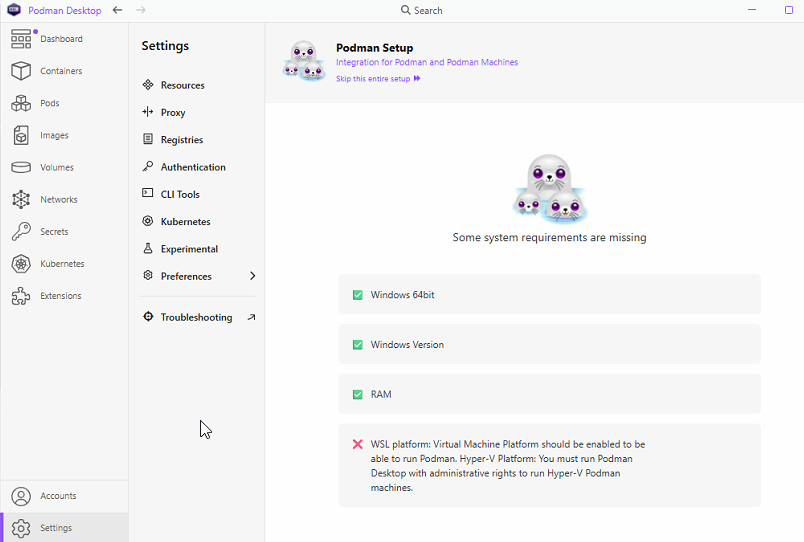

**Legacy Podman pilot track only. For new installations without Podman/WSL2, use WI-11 - Install DRISHTI HyperShift as Native Windows Services.**

**WORK INSTRUCTION**

**Enable Podman Desktop inside a Windows VMware VM**

Nested virtualization, WSL 2, Podman machine setup, validation, and rollback

| **Document ID** | WI-09 | Version 1.0 |
| --- | --- | --- |
| **Effective date** | August 8, 2026 | Owner: DRISHTI HyperShift Operations |

| **Safety: **The Windows VM running HyperShift is the migration controller. Do not select this VM as the VMware source while it is operating HyperShift. |
| --- |

# Purpose and expected result

Use this instruction when Podman Desktop reports that Virtual Machine Platform is missing inside a Windows 11 VM hosted by VMware vSphere or ESXi. When complete, Windows exposes nested virtualization, WSL uses version 2, and the Podman machine starts successfully.

# Scope and prerequisites

| **Requirement** | **Minimum condition** |
| --- | --- |
| **Windows guest** | Windows 11 64-bit with local administrator access |
| **VMware access** | Permission to shut down the VM and edit its CPU settings |
| **Host support** | ESXi host and CPU support nested virtualization |
| **Pilot sizing** | Recommended 4 vCPU, 8 GB RAM, and adequate workspace disk capacity |
| **Change safety** | Backups confirmed before deleting any Podman machine or WSL data |

# Procedure

## Step 1 - Shut down and expose virtualization

Shut down the Windows 11 guest cleanly. In vCenter or the ESXi Host Client, open the VM's Edit Settings page, expand CPU, enable Expose hardware-assisted virtualization to the guest OS, save, and then power on the VM.

| **Authorization: **Do not change physical-host firmware, security settings, or organization-wide policy without approval. |
| --- |

## Step 2 - Enable the Windows components

Open PowerShell as Administrator and run both commands:

| dism.exe /online /enable-feature /featurename:Microsoft-Windows-Subsystem-Linux /all /norestart dism.exe /online /enable-feature /featurename:VirtualMachinePlatform /all /norestart |
| --- |

Restart Windows before continuing.

## Step 3 - Update and configure WSL 2

After restart, open PowerShell as Administrator and run:

| wsl --update wsl --set-default-version 2 |
| --- |

If Windows reports that WSL is not installed, run the following command and restart again:

| wsl --install --no-distribution |
| --- |

## Step 4 - Complete Podman Desktop setup

Open Podman Desktop, return to Podman Setup, select the WSL-based Podman machine, create it, and start it. Podman Desktop should show a running engine rather than the missing-requirement warning.

_Figure 1. Podman Desktop warning before Virtual Machine Platform is enabled._

# Validation and acceptance

Run the following commands in PowerShell:

| wsl --status wsl --list --verbose podman machine list podman info |
| --- |

| **Check** | **Acceptance criterion** | **Result** |
| --- | --- | --- |
| **Task Manager > Performance > CPU** | Virtualization shows Enabled | Pass / Fail |
| **wsl --list --verbose** | Podman-related WSL distribution reports version 2 | Pass / Fail |
| **podman machine list** | Machine reports Running | Pass / Fail |
| **podman info** | Client and server information is returned without an error | Pass / Fail |
| **Podman Desktop** | No missing Virtual Machine Platform warning remains | Pass / Fail |

# Troubleshooting

## Virtual Machine Platform remains unavailable

Confirm the guest was fully powered off, not suspended, when the VMware CPU option was changed. Recheck Expose hardware-assisted virtualization to the guest OS. Use Task Manager and systeminfo to verify virtualization is visible inside Windows.

## WSL update fails

Install approved Windows updates and restart. Confirm internet access or use the organization's approved offline WSL package. Check whether Group Policy blocks WSL or Microsoft Store components.

## Podman machine does not start

| podman machine list podman machine stop podman machine start |
| --- |

| **Data protection: **Do not delete a Podman machine containing HyperShift data until PostgreSQL, configuration, and worker-workspace backups are verified. |
| --- |

# Rollback

Stop the Podman machine and close Podman Desktop. Back up required HyperShift configuration, PostgreSQL data, and the worker workspace. If change control requires reversal, disable the Windows components with the commands below and restart Windows:

| dism.exe /online /disable-feature /featurename:VirtualMachinePlatform /norestart dism.exe /online /disable-feature /featurename:Microsoft-Windows-Subsystem-Linux /norestart |
| --- |

If required, power off the VM and clear Expose hardware-assisted virtualization to the guest OS in VMware. Disabling WSL or removing a Podman machine can make container data unavailable, so backup verification is mandatory.

# Reference

Official Podman Desktop downloads: https://podman-desktop.io/downloads

Companion knowledge-base article: 09-podman-desktop-on-windows-vmware.md

## Related Documents

- [[192.168.1.1 - wbshocket findings|192.168.1.1 Wbshocket Findings]]
- [[Drishti_Line_Side_Board_Work_Instruction|Drishti Line Side Board Work Instruction]]
- [[DRISHTI-NOC-Audit-Report|DRISHTI NOC Audit Report]]
- [[DRISHTI_NOC_Codex_Remediation_Steps|DRISHTI NOC Codex Remediation Steps]]
- [[DRISHTI_NOC_Codex_Remediation_Steps|DRISHTI NOC Codex Remediation Steps]]
- [[DRISHTI_NOC_Codex_Remediation_Steps|DRISHTI NOC Codex Remediation Steps]]
- [[DRISHTI_NOC_Multi_Plant_Federation_Project_Plan|DRISHTI NOC Multi Plant Federation Project Plan]]
- [[DRISHTI_NOC_Multi_Plant_Federation_Project_Plan|DRISHTI NOC Multi Plant Federation Project Plan]]
- [[DRISHTI-RiskAssesment_Phased_Codex_Build_Plan|DRISHTI Riskassesment Phased Codex Build Plan]]
- [[DRISHTI_Server_Hardening_Report|DRISHTI Server Hardening Report]]
- [[DRISHTI_SiteOps_Agent_Brief|DRISHTI Siteops Agent Brief]]
- [[WI-10-Windows-Installer-Workspace-Capacity|WI 10 Windows Installer Workspace Capacity]]
- [[WI-11-Native-Windows-Installation|WI 11 Native Windows Installation]]
- [[WI-IT-OT-001_FleetManager_Server_Build_Standard_v1.0|WI IT OT 001 Fleetmanager Server Build Standard V1.0]]
- [[WI-IT-SEC-001_Ubuntu_Base_Image_Security_Hardening_Standard_v1.0|WI IT SEC 001 Ubuntu Base Image Security Hardening Standard V1.0]]
- [[WI-IT-SEC-001_Ubuntu_Base_Image_Security_Hardening_Standard_v1.0|WI IT SEC 001 Ubuntu Base Image Security Hardening Standard V1.0]]
